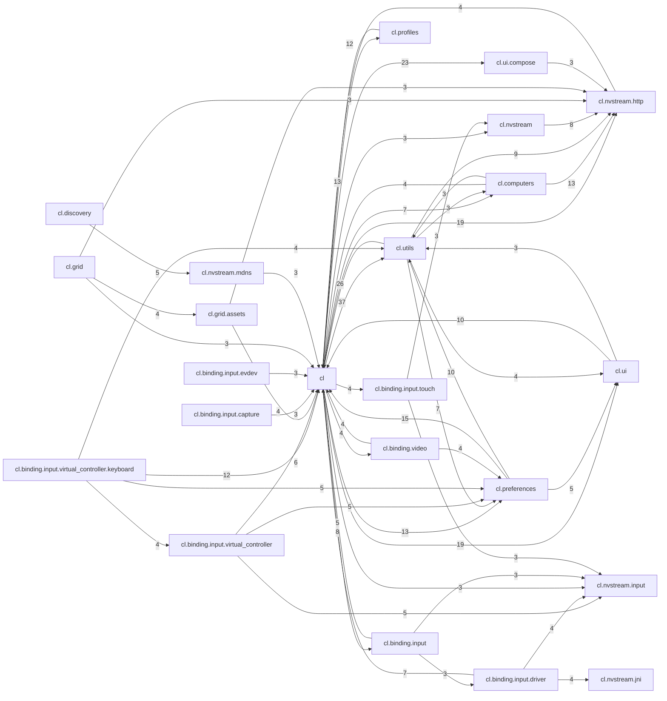

<!-- GERADO POR tools/codemap/codemap.mjs — NÃO EDITE À MÃO. Rode: node tools/codemap/codemap.mjs -->

# Grafo de Dependências

> Acoplamento entre pacotes, derivado dos imports `com.limelight.*`. Use para prever o raio de impacto de uma mudança.

## Pacotes por centralidade

| Pacote | PageRank | Arquivos | Linhas |
|---|--:|--:|--:|
| `com.limelight` | 224.7 | 28 | 14489 |
| `com.limelight.nvstream.http` | 119.0 | 8 | 2001 |
| `com.limelight.utils` | 88.7 | 28 | 6926 |
| `com.limelight.nvstream.jni` | 66.8 | 1 | 445 |
| `com.limelight.preferences` | 49.6 | 11 | 4133 |
| `com.limelight.nvstream` | 49.1 | 4 | 999 |
| `com.limelight.ui` | 44.0 | 23 | 4503 |
| `com.limelight.ui.compose` | 34.5 | 1 | 163 |
| `com.limelight.nvstream.av.audio` | 33.8 | 1 | 16 |
| `com.limelight.nvstream.av.video` | 29.2 | 1 | 22 |
| `com.limelight.nvstream.input` | 23.5 | 3 | 51 |
| `com.limelight.profiles` | 21.2 | 8 | 1002 |
| `com.limelight.computers` | 19.9 | 7 | 1626 |
| `com.limelight.binding.input` | 19.7 | 9 | 4934 |
| `com.limelight.nvstream.mdns` | 14.2 | 5 | 733 |
| `com.limelight.binding.input.capture` | 13.0 | 6 | 403 |
| `com.limelight.binding.input.evdev` | 12.2 | 6 | 627 |
| `com.limelight.binding.video` | 12.2 | 7 | 3923 |
| `com.limelight.binding` | 12.0 | 1 | 15 |
| `com.limelight.grid.assets` | 11.4 | 5 | 817 |
| `com.limelight.binding.input.virtual_controller.keyboard` | 11.4 | 13 | 4370 |
| `com.limelight.binding.input.touch` | 11.1 | 4 | 1104 |
| `com.limelight.binding.input.driver` | 10.4 | 8 | 1696 |
| `com.limelight.binding.audio` | 10.3 | 3 | 918 |
| `com.limelight.binding.crypto` | 10.3 | 1 | 260 |
| `com.limelight.binding.input.virtual_controller` | 9.0 | 13 | 2816 |
| `com.limelight.grid` | 8.9 | 3 | 462 |
| `com.limelight.nvstream.wol` | 8.9 | 1 | 150 |
| `com.limelight.discovery` | 7.3 | 1 | 91 |
| `com.limelight.nvstream.av` | 6.7 | 1 | 58 |
| `com.limelight.shadows` | 6.7 | 3 | 72 |

## Mapa de dependências (Mermaid)

Arestas com peso >= 3 (número de imports distintos entre os pacotes).

## Comunidades detectadas

Agrupamento por label propagation — pacotes que mudam juntos com mais probabilidade.

**Comunidade 1** (29): `com.limelight`, `com.limelight.binding`, `com.limelight.binding.audio`, `com.limelight.binding.crypto`, `com.limelight.binding.input`, `com.limelight.binding.input.capture`, `com.limelight.binding.input.driver`, `com.limelight.binding.input.evdev`, `com.limelight.binding.input.touch`, `com.limelight.binding.input.virtual_controller`, `com.limelight.binding.input.virtual_controller.keyboard`, `com.limelight.binding.video`, `com.limelight.computers`, `com.limelight.discovery`, `com.limelight.grid`, `com.limelight.grid.assets`, `com.limelight.nvstream`, `com.limelight.nvstream.av.audio`, `com.limelight.nvstream.av.video`, `com.limelight.nvstream.http`, `com.limelight.nvstream.input`, `com.limelight.nvstream.jni`, `com.limelight.nvstream.mdns`, `com.limelight.nvstream.wol`, `com.limelight.preferences`, `com.limelight.profiles`, `com.limelight.ui`, `com.limelight.ui.compose`, `com.limelight.utils`

